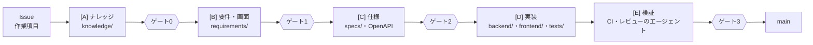

# 総合原価管理システム(予実管理)

[](https://github.com/kyamanaka0923/fcpl-cost-management-system/actions/workflows/ci.yml)

**課(部門)単位の半期予算の策定・実績計上・差異分析**を行うシステムです。
明細は数量×単価ではなく**金額**で直接管理します。金額は **0 以上の 1 円単位の整数**で、
1 円未満の端数は入力欄に入れられず、API にも受け付けられません(400)。

- 組織は **部 > 課** の2階層です。課は必ず1つの部に属し、**部では配下課の予算・予実を合計**して把握できます
  (部自体は予算を策定しない集計ビュー)。部詳細は「予算(計画)」タブ(区分別の予算・計画損益・粗利率と、
  課ごとの予算比較グリッド)と「予実サマリ」タブ(予実の差異)に分かれ、どの課の損益が弱いかを比較できます
- 課の承認に加えて**部単位の予算承認**ができます。部承認は配下課がすべて承認済みになると可能で、
  課の承認とは独立(部承認後に課が改定しても部承認は残る)。取り消しもできます
- 予算は**課 × 半期(年度の上期/下期)**ごとに策定し、**バージョン管理**され、半期の途中でも何度でも改定できます
- 予算は **売上高・加工費・外注費・期間費用の4区分**を1つの予算としてまとめて承認します
- **売上高・加工費・外注費は案件別の詳細計画**として立案します。課の区分合計 = 案件明細の合計
  (課レベルの直接入力はできません)
- **期間費用**は費目別(人件費・ライセンス費など。費目マスタで拡張可能)に計画します。
  費目内は**明細名(自由入力)でさらに細分**できます(例: ライセンス費 → AWS / GitHub)。
  細分不要な費目(人件費など)は従来どおり費目一括の1金額でも入力でき、費目合計は明細の合計になります(Issue #7)
- 明細は**半期一括の金額**が基本ですが、**明細ごとに月次入力**もできます(各セルの「月次入力」で
  月ごとの金額を入力すると半期合計が自動算出。表示・集計・差異分析は半期のまま)。実績も計上月を任意で指定できます
- 予実の**差異分析**: 差異 = 実績金額 − 予算金額(コストは予算超過で利益が減り、売上は予算超過で利益が増える)
- **損益分析**: 課全体(売上高 − 総コスト)と案件別(売上高 − 加工費 − 外注費。期間費用は課共通)。
  計画損益・損益実績には**粗利率(損益 ÷ 売上高)**を併記します
- 予算バージョン間の**変動比較**(例: 当初予算 vs 上期見直し)ができます

操作手順は **[操作マニュアル](docs/MANUAL.md)**(計画策定 → 実績入力 → 計画変更)、
設計の詳細は **[設計ドキュメント](docs/DESIGN.md)**(コンテキストマップ / C4 モデル / クラス図)を参照してください。
要件は **[要件定義書](docs/REQUIREMENTS.md)**(機能要件 / 非機能要件 / アーキテクチャ制約)、
設計判断の経緯は **[アーキテクチャ決定記録(ADR)](docs/adr/README.md)** にまとめています。
開発は AI エージェントと人の分担で進めています(**[開発の進め方(工場)](#開発の進め方工場)**)。

## 開発の進め方(工場)

このリポジトリは、AI エージェント(Claude Code)が書き、人が「何を作るか」と「出してよいか」を決める
**工場(ソフトウェアファクトリー)**の形で開発しています。決定は [ADR-0015](docs/adr/0015-software-factory.md)、
エージェントへの共通の指示は [AGENTS.md](AGENTS.md) です。
工場を回す人(要望を出す・問いに答える・ゲートで判定する人)向けの案内は **[工場の回し方](docs/factory/README.md)** です。



- **すべてのゲートで、人が PR を main にマージするまで次の工程に進みません。** ゲート0〜2 を通ったことは、
  人が Issue に付けるゲートラベル(`gate0-approved` など)で表します
- 工程ごとにブランチを分けます(`knowledge/<n>-…` `req/<n>-…` `spec/<n>-…` `impl/<n>-…` `prep/<n>-…` `factory/…`)。
  ブランチごとに触ってよい場所が決まっていて、CI が検査します
- エージェントはマージ・承認・ゲートラベルの付与ができません(`.claude/settings.json` とフック `.claude/hooks/guard.sh`、main のルールセットが止めます)

| 置き場 | 中身 |
|---|---|
| [knowledge/](knowledge/README.md) | 業務の知識の正: 用語集・業務ルール(`BR-…`。出どころ必須)・未確定事項・レビューの観点 |
| [requirements/](requirements/README.md) | 要件(EARS。1 件 1 ファイル)。触った機能から [要件定義書](docs/REQUIREMENTS.md) より移していく。受け入れ条件は `.feature` の `ルール:` と `@FR-x.y` タグ |
| [requirements/screens/](requirements/screens/README.md) | 画面要件: 画面ごとの状態・fixtures・**人が承認した画面の画像** |
| [specs/](specs/README.md) | 仕様: 処理ルール(`SPEC-…`)・テスト計画。WebAPI 仕様は [docs/api/openapi.json](docs/api/openapi.json) |
| `.claude/agents/`・`.claude/skills/` | 工程ごとのエージェント(書く役と確かめる役を分ける)と手順 |
| [tools/factory/](tools/factory/README.md) | ゲートの検査(EARS・曖昧語・網羅・持ち場・ゲートラベル・前提の版・画面の差分など)と週報 |
| `.factory/` | 工場の版(`VERSION`・`CHANGELOG.md`)、工場の変更の記録(`changes/`)、作業ごとの前提の記録 |

人(判定する人)がすること:

| すること | どうやって |
|---|---|
| ゲートの承認 | PR を読んで GitHub で **Merge pull request**。ゲート0〜2 は、Issue にゲートラベルを付けて列(`stage:…`)を進める |
| 問いへの回答 | `needs-answer` の Issue や PR の「問い」に答える |
| 画面の承認 | `bash tools/factory/update-approved-screens.sh` で撮り、画像を確かめてコミットする |
| 介入の記録 | 手を出したら `/intervention <種類> <原因>` とコメントする。毎週月曜に「工場の週報」Issue に集計が出る |
| GitHub の設定 | 検査を足したあとで `bash tools/factory/setup-github.sh`(ラベルと必須チェック) |

## 技術スタック

バージョンは `*.csproj` / `frontend/package-lock.json` / `tests/unit/frontend/package-lock.json` / `tests/e2e/browser/package-lock.json` / `tests/.config/dotnet-tools.json` の実値です。

### アプリケーション

| 区分 | 技術 | バージョン | 用途 |
|---|---|---|---|
| フロントエンド | React / React DOM | 19.2 | SPA |
| | React Router(react-router-dom) | 7 | 画面遷移 |
| | TypeScript | 5.8(`strict`) | 型付け |
| | Vite + @vitejs/plugin-react | 6.4 / 4.7 | 開発サーバ(`/api` をバックエンドへプロキシ)・ビルド |
| | グラフ | (外部ライブラリなし) | `components/charts.tsx` の自前 SVG |
| バックエンド | .NET / ASP.NET Core Minimal API | 10(`net10.0`) | HTTP API |
| | Amazon.Lambda.AspNetCoreServer.Hosting | 2.1 | AWS Lambda 上での実行(ローカルでは通常の Kestrel) |
| ログ | .NET 標準ロギング(Microsoft.Extensions.Logging)+ JSON コンソール出力 | 10 | 業務イベント・リクエストの構造化ログ。AWS では CloudWatch Logs で検索 |
| 認証 | Amazon Cognito + Microsoft.AspNetCore.Authentication.JwtBearer | — / 10.0.9 | ログイン(Hosted UI・認可コード + PKCE)と API のアクセストークン検証。ローカル開発では無効 |
| データ | SQLite(Microsoft.Data.Sqlite + SQLitePCLRaw.bundle_e_sqlite3) | 10.0.9 / 3.0.3 | 永続化(単一ファイル DB) |
| | Dapper | 2.1.79 | マイクロ ORM。SQL は手書きし、結果をオブジェクトへ詰め替える(EF Core のような変更追跡・LINQ 変換・マイグレーション機能を持つフル機能 ORM は使わない) |
| API 定義 | OpenAPI 3.1(Microsoft.AspNetCore.OpenApi)+ openapi-typescript | 10.0.9 / 7.13 | エンドポイントから OpenAPI 定義を生成し(`docs/api/openapi.json`)、フロントの TypeScript 型を自動生成 |
| 設計 | ヘキサゴナルアーキテクチャ + ドメイン駆動設計(戦術パターン) | — | 依存は Domain に向かう。ルールは NetArchTest で検査 |

### テスト・品質

| 区分 | 技術 | バージョン | 用途 |
|---|---|---|---|
| 単体〜API テスト | xUnit | 2.9.3 | バックエンドのテスト全般(テスト名は日本語) |
| | Microsoft.AspNetCore.Mvc.Testing | 10.0.9 | API E2E(WebApplicationFactory で WebApi を起動) |
| | NetArchTest.Rules | 1.3.2 | アーキテクチャ(層の依存ルール)テスト |
| | CsCheck | 4.9.1 | プロパティベーステスト(ランダム入力で不変条件を検証) |
| | Reqnroll.xUnit | 3.3.4 | 日本語 Gherkin の業務シナリオテスト(Application・API E2E) |
| フロント単独テスト | Vitest | 3.2 | 画面とロジックの単独テスト(jsdom。ブラウザを起動しない) |
| | Testing Library(React)+ user-event | 16.3 / 14.6 | 利用者と同じ操作で画面を動かして検証 |
| | MSW(Mock Service Worker) | 2.15 | API を HTTP の層でモック |
| ブラウザ E2E | Playwright(@playwright/test) | 1.64 | 実ブラウザ(Chromium)での画面操作テスト |
| | playwright-bdd | 9.2 | ブラウザ E2E を日本語 Gherkin で記述(.feature から Playwright のテストを生成) |
| カバレッジ | coverlet + ReportGenerator | 10.1.0 / 最新 | 計測と CI 実行サマリへの表示 |
| ミューテーション | Stryker.NET(dotnet ローカルツール) | 5.0.0 | テストが仕様を検証しているかの測定(Domain・Application) |
| メトリクス | cloc + scc | 最新 | 行数・複雑度の集計 |
| 静的解析(フロント) | ESLint + typescript-eslint + eslint-plugin-react-hooks | 9.39 / 8.71 / 7.1 | TypeScript の推奨ルールと React Hooks の規則(`npm run lint`) |
| フォーマッタ(フロント) | Prettier(+ eslint-config-prettier) | 3.9 | 書式の統一(`npm run format` / `npm run format:check`) |
| 静的解析(バックエンド) | .NET アナライザ(`AnalysisLevel=latest-recommended`)+ 警告をエラー扱い | .NET 10 SDK 同梱 | `backend/Directory.Build.props` で全プロジェクトに適用。方針に合わないルールは `.editorconfig` で理由つきで無効化 |
| 書式設定(共通) | EditorConfig | — | リポジトリ直下の `.editorconfig`(文字コード・改行・インデント・C# のスタイル) |

### 開発環境・CI・デプロイ

| 区分 | 技術 | 内容 |
|---|---|---|
| 開発環境 | Docker / docker compose / VS Code Dev Containers | `docker/dev.Dockerfile`(.NET 10 SDK + Node.js 22)を共用 |
| CI | GitHub Actions(ubuntu-latest) | `ci.yml`: バックエンド(ビルド・テスト・カバレッジ)/ フロントエンド(ESLint・Prettier・型チェック・ビルド)/ フロントエンド単独テスト / ブラウザE2E / ミューテーションテスト / コードメトリクス。`factory.yml`: 工場のゲートの検査(フック・検査スクリプトのテスト・画面の差分と 10 の検査。[tools/factory/](tools/factory/README.md))。`factory-metrics.yml`・`factory-intervention.yml`: 週報と介入の記録 |
| 依存の自動更新 | Dependabot | NuGet・npm・GitHub Actions・Docker ベースイメージを毎週月曜 09:00 JST に確認して PR を作成(`.github/dependabot.yml`)。マイナー・パッチはまとめて1件、メジャーは個別 |
| デプロイ | AWS SAM | Lambda(`provided.al2023`, arm64)+ EFS(SQLite)+ S3 + CloudFront + Cognito + AWS Backup(EFS を日次バックアップ)。詳細は [infra/README.md](infra/README.md) |

## アーキテクチャ

ヘキサゴナル(ポート&アダプタ)構成。依存はすべて内側(Domain)に向かいます。

```
backend/
├── src/
│   ├── CostManagement.Domain/          # 中心: エンティティ・値オブジェクト・集約・
│   │   │                               #       ドメインサービス・リポジトリポート
│   │   ├── Shared/                     #   Money, FiscalHalf(値オブジェクト)
│   │   ├── Divisions/                  #   Division(部)集約
│   │   ├── Departments/                #   Department(課。部に属する)集約
│   │   ├── Projects/                   #   Project(案件。課に属するマスタ)集約
│   │   ├── CostElements/               #   CostElement(期間費用の費目マスタ)集約
│   │   ├── Budgeting/                  #   DepartmentBudget 集約(4区分・バージョン管理・承認)
│   │   ├── Actuals/                    #   ActualEntry 集約(実績)
│   │   └── Analysis/                   #   差異分析・バージョン比較・損益・部集計のドメインサービス群
│   ├── CostManagement.Application/     # ユースケース(入力ポート)・DTO
│   ├── CostManagement.Infrastructure/  # 出力アダプタ: Dapper + SQLite リポジトリ実装
│   └── CostManagement.WebApi/          # 入力アダプタ: HTTP API(Minimal API。Lambda でも動く)
└── CostManagement.slnx                 # ソリューション(../tests/ の .NET テストプロジェクトも含む)

frontend/                               # React SPA(/api を dev proxy 経由でバックエンドへ)
└── src/
    ├── pages/                          #   画面(部・課・予算編集・実績・分析・比較・費目マスタ)
    ├── components/                     #   グラフ(自前 SVG)・モーダル・トースト・金額入力
    └── api.ts                          #   API クライアントと型

tests/                                  # テスト(unit / integration / e2e / architecture のスコープ別。詳細は「テスト」の節)
infra/                                  # AWS SAM テンプレートとデプロイスクリプト
docker/                                 # 開発・ビルド・テスト共用イメージ
docs/                                   # マニュアル・設計・要件・ADR・解説 HTML(docs/design/)・OpenAPI 定義(docs/api/)
```

### ドメインモデル(DDD 戦術パターン)

| 要素 | 実装 |
|---|---|
| 集約ルート | `Division`(部), `DivisionBudgetApproval`(部承認), `Department`(課), `Project`(案件), `DepartmentBudget`(課予算), `ActualEntry`(実績), `CostElement`(費目マスタ) |
| エンティティ | `BudgetLine`(区分 × 案件 or 費目 × 金額。案件系区分と期間費用でキーが排他) |
| 値オブジェクト | `Money`, `FiscalHalf`(yyyy-H1 / yyyy-H2), `DivisionId` / `DepartmentId` 等の型付き ID, `CostElementCode` |
| ドメインサービス | `BudgetVarianceAnalysisService`(予実差異分析), `BudgetComparisonService`(バージョン間比較), `ProfitAnalysisService`(課全体・案件別の損益), `DivisionBudgetSummaryService`(部の予実集計) |
| リポジトリ(ポート) | `IDivisionRepository`, `IDivisionBudgetApprovalRepository`, `IDepartmentRepository`, `IProjectRepository`, `ICostElementRepository`, `IDepartmentBudgetRepository`, `IActualEntryRepository` |
| ドメイン例外 | `DomainException`(不変条件違反 → HTTP 400 に変換) |

### 予算の構成と区分

課の半期予算は次の4区分で構成され、1つの予算としてまとめて承認します。

| 区分 | 明細のキー | 意味 |
|---|---|---|
| 売上高(Revenue) | 案件 | 案件ごとの売上計画 |
| 加工費(Processing) | 案件 | 案件ごとの加工費計画 |
| 外注費(Outsourcing) | 案件 | 案件ごとの外注費計画 |
| 期間費用(PeriodCost) | 費目 | 課共通の費用(人件費・ライセンス費など) |

課の区分合計は常に明細の合計として導出されます(ヘッダに金額を持たないため、
案件明細と課合計が食い違うことは構造的に起こりません)。

### 予算のライフサイクル

```
当初予算 v1 (Draft) ── 承認 ──> v1 (Approved)
                                    │ 見直し(明細を引き継いでドラフト起票)
                                    v
                         v2 (Draft) ── 承認 ──> v2 (Approved)
                                                 v1 は Superseded(履歴として保持)
```

主な不変条件:

- 承認済み・失効済みの予算は編集不可(改定版の作成が必要)
- 明細のない予算は承認不可
- 策定中のドラフトは同一(課, 半期)に 1 つまで
- 同一(課, 半期)内でバージョン番号は単調増加
- 新バージョンの承認により、旧承認版は自動的に失効(Superseded)
- 売上高・加工費・外注費の明細は案件必須(その課に属する案件のみ)、期間費用の明細は費目必須

### 差異分析(変動分析)

明細は金額で管理されるため、差異は「実績金額 − 予算金額」で符号付きに算出します。

- **コスト(加工費・外注費・期間費用)**: (区分, 案件 or 費目) の粒度で突き合わせ。正 = 予算超過 = 利益が減る
- **売上高**: (案件) の粒度で突き合わせ。正 = 売上超過 = 利益が増える(コストと逆)

同一キーに複数の実績がある場合は合算されます。予算にない実績は「予定外」として報告されます。

### 損益分析

`ProfitAnalysisService` が課全体と案件別の損益予実を算出します。

- **課全体の損益** = 売上高 −(加工費 + 外注費 + 期間費用)。利益率(損益 ÷ 売上高)も算出
- **案件別の損益** = 売上高 − 加工費 − 外注費。期間費用は課共通のため案件には配賦しません
- 案件別損益の合計 − 期間費用 = 課全体の損益(整合性はテストで担保)

### 管理できる費目(費目マスタ)

費目マスタは**期間費用**の明細に使う、**システム全体で共通のマスタ**です(課ごとの設定ではありません)。
専用の「**費目マスタ**」画面(画面右上のナビ / `/cost-elements`)で追加・一覧でき、
追加した費目はすべての部・課の予算編集・実績入力で共通して使えます。初回起動時に以下の標準費目がシードされます。

| コード | 費目名 |
|---|---|
| `PERSONNEL` | 人件費 |
| `LICENSE` | ライセンス費 |

費目は `POST /api/cost-elements` で追加できます(コード・名称を指定。コードは重複不可)。
シードは `INSERT OR IGNORE` のため、追加・既存データに影響しません。

### 案件(Project)コードの一意性と編集

案件は課に属するマスタで、**案件コードは課ごとに一意**です。別の課であれば同じ案件コードを使えます。

案件のコード・名称は**登録後も編集**できます(予算編集画面の案件行の「編集」)。案件の同一性は
**生成時に採番される GUID(`ProjectId`)**で保たれ、予算明細・実績はこの GUID で案件を参照するため、
コードや名称を変更しても既存の予算・実績の紐づけは壊れません。編集時も課ごとのコード一意性は検証されます。

### スキーマの作り直し

旧世代(プロジェクト単位予算)のテーブルが残っているデータベースは、起動時に旧テーブルを
破棄して新スキーマで作り直します(**データ移行は行いません**)。部を持たない旧世代の
`departments`(`division_id` 列がない)も、配下テーブル(projects / department_budgets /
department_budget_lines / actual_entries)ごと破棄して作り直します。
この処理は冪等で、新スキーマの既存データには影響しません。

一方、現世代スキーマ内での変更(既存データが衝突しないもの)は、既存データを**保持したまま**
テーブルを変更するマイグレーションを起動時に実行します(冪等で、移行済みなら何もしません)。
現在は次の4つを順に実行します:

- **案件コードの一意制約を「グローバル一意」→「課ごとに一意」へ変更**(`projects` を作り直し。制約の緩和のみ。Issue #1)
- **案件の終了ステータス(`status` 列)を廃止**(`projects` を作り直し。案件は終了の概念を持たなくなったため。Issue #2)
- **実績に計上月(`month` 列)を追加**(`actual_entries` に列追加。Issue #5)
- **期間費用の明細名(`period_detail` 列)を追加**(予算明細は一意制約に含めるため作り直し、実績は列追加。Issue #7)

## 実行方法

### Docker / VS Code Dev Containers(推奨)

ローカルに .NET SDK / Node.js を入れなくても、Docker だけでビルド・テスト・起動できます
(開発用イメージ `docker/dev.Dockerfile` = .NET 10 SDK + Node.js 22 を共用)。

```bash
# アプリ起動(バックエンド http://localhost:5100 / フロントエンド http://localhost:5173)
docker compose up backend frontend

# バックエンドのテスト
docker compose run --rm backend-test

# フロントエンドの型チェック + ビルド
docker compose run --rm frontend-build
```

VS Code でのリモート開発は、拡張機能「Dev Containers」を入れてリポジトリを開き、
「Reopen in Container」を選ぶだけです(`.devcontainer/devcontainer.json` が使われます)。
コンテナ内で `dotnet restore` / `npm install` が自動実行され、ポート 5100/5173 が
フォワードされます。ビルド・テストは `.vscode/tasks.json` のタスク
(`backend: test`、`full: backend + frontend` など)から実行できます。
デバッグ実行は `.vscode/launch.json` の構成(`full: backend デバッグ + frontend` など)を使います。

devcontainer は、AI エージェント(Claude Code)を安全に動かすための守りを持っています(ADR-0015)。

- **外への通信は許可リストだけ**: 起動のたびに `docker/init-firewall.sh` が、GitHub・Anthropic・npm・NuGet・Playwright・VS Code の拡張機能の宛先以外を止めます。ほかの宛先が要るときは、このスクリプトの `ALLOWED_DOMAINS` に足してコンテナを作り直します
- **sudo はファイアウォールと volume の持ち主の直しだけ**: `apt install` などはできません。道具が要るときは `docker/dev.Dockerfile` に足します(docker compose で使うイメージは、これまでどおり sudo を制限しません)
- Claude Code は devcontainer の Feature で入り、設定と会話の記録は named volume(`fcpl-claude-config`)に残ります

### バックエンド(ローカルに SDK がある場合)

ビルドでは .NET アナライザの推奨ルールが働き、**警告はエラーとして扱われます**(`backend/Directory.Build.props`)。
ロケールに依存する数値の書式化・解析などはビルドが通らないので、`CultureInfo.InvariantCulture` などで明示してください。

```bash
cd backend
dotnet run --project src/CostManagement.WebApi
# => http://localhost:5100 (初回起動時に costmanagement.db を自動作成・費目マスタをシード)
```

### フロントエンド

```bash
cd frontend
npm install
npm run dev
# => http://localhost:5173 (/api は localhost:5100 にプロキシ)

npm run lint           # ESLint(TypeScript・React Hooks の規則)
npm run format         # Prettier で整形(確認だけなら npm run format:check)
```

### テスト

テストはすべてリポジトリ直下の `tests/` に置き、**テストのレベル(スコープ)でフォルダを分けて**います。
テスト名はすべて日本語の文で、テスト一覧がそのまま仕様書として読めるようにしています。
速いテストで確かめられることは速いテストに書き、遅い E2E は部品のつながりの確認に絞ります。

```bash
cd backend && dotnet test               # .NET のテストすべて(単体・結合・API E2E・アーキテクチャ)
cd tests/unit/frontend && npm test      # フロントエンド単独テスト(初回は npm ci)
cd tests/e2e/browser && npm test        # ブラウザ E2E(初回は frontend と tests/e2e/browser で npm ci、npx playwright install chromium)
```

#### tests/ のフォルダ構成

```
tests/
├── unit/                     レベル: 単体        1つの部品だけ。DB・HTTP・ブラウザを使わない(速い)
│   ├── backend/Domain/         ドメイン(集約・値オブジェクト・ドメインサービス)
│   └── frontend/               画面のロジックとコンポーネント(独立した npm パッケージ)
├── integration/              レベル: 結合        本物の SQLite を通す
│   └── backend/
│       ├── Application/        ユースケース(アプリケーション層 + 本物のリポジトリ)
│       └── Infrastructure/     リポジトリの永続化往復・スキーマの作り直し
├── e2e/                      レベル: E2E         システムを外側から操作する(遅い)
│   ├── api/                    HTTP 経由で WebApi 全体(プロジェクト名は CostManagement.E2E.Tests)
│   └── browser/                画面 → API → DB(独立した npm パッケージ)
├── architecture/             レベル: 構造        動作ではなくコードの構造を検査する(スコープの軸に乗らないので別枠)
│   └── backend/                ヘキサゴナルアーキテクチャの層の依存ルール
├── Directory.Build.props     backend/Directory.Build.props(アナライザ設定・警告のエラー扱い)を取り込む
└── .config/dotnet-tools.json Stryker.NET(ミューテーションテスト)のツールマニフェスト
```

.NET のテストプロジェクトの中は同じ型で並べます。

| 置き場所 | 中身 |
|---|---|
| 直下 | xUnit の例示テスト(`*Tests.cs`) |
| `PropertyBased/` | CsCheck のプロパティベーステストと入力の生成器 |
| `Features/` | 日本語 Gherkin のシナリオ(`*.feature`) |
| `Steps/` | Gherkin のステップ定義 |
| `Support/` | フィクスチャ・シナリオの状態などの共通部品 |

npm パッケージ(`unit/frontend`・`e2e/browser`)は Node の慣習どおり小文字で、
`unit/frontend` は `logic/`(純粋関数)・`components/`・`pages/<画面名>/`・`support/`、
`e2e/browser` は `features/`・`steps/`・`support/` です。

#### 観点1: テストのレベルとスコープ

| フォルダ | レベル | 確かめる範囲 | 本物を使うもの | 置き換えるもの |
|---|---|---|---|---|
| `unit/backend/Domain` | 単体 | 集約の不変条件、差異・損益・部集計の計算規則 | ドメインのクラスだけ | (依存がない) |
| `unit/frontend` | 単体 | 表示の書式、会計半期の境界、予算明細の計算、金額入力・トースト、予算編集画面と実績入力画面の操作と送るリクエスト | `frontend/src` の画面とロジック、React | API(MSW のモック)、ブラウザ(jsdom) |
| `integration/backend/Application` | 結合 | ユースケースと業務ルール(予算の策定→改定→承認、実績計上、分析、部承認、マスタ) | アプリケーション層・ドメイン・リポジトリ・SQLite | 時計(`FixedClock`) |
| `integration/backend/Infrastructure` | 結合 | 保存した集約が同じ状態で戻ること、旧スキーマの破棄と作り直しの冪等性 | リポジトリ・SQLite | — |
| `e2e/api` | E2E | ルーティング・JSON 変換・エラーの HTTP ステータス・認証・OpenAPI 定義との一致 | WebApi 全体・SQLite | ネットワーク(プロセス内の TestServer)、Cognito(テスト用の鍵で署名したトークン) |
| `e2e/browser` | E2E | 画面の操作が API を通して保存され、ほかの画面に反映されること | ブラウザ・画面・WebApi・SQLite のすべて | (モックなし) |
| `architecture/backend` | 構造 | 層の依存の向き、ポートとアダプタの置き場所、ドメインの規約 | コンパイル済みのアセンブリ | — |

画面だけの振る舞い(折りたたみ・入力チェック・送るリクエストの中身・トースト)は `unit/frontend`、
業務ルールは `integration/backend/Application`、画面→API→DB のつながりだけを `e2e/browser` で確かめます。

#### 観点2: テスト仕様の源泉

要件の大元は [要件定義書](docs/REQUIREMENTS.md)(FR-1〜FR-10・NFR)と、
設計判断を記録した [ADR](docs/adr/README.md) です。工場に移した要件は [requirements/](requirements/README.md) が正で、`.feature` の `ルール:` に要件文と `@FR-x.y` タグを書き、CI の「要件とシナリオの網羅」が要件ごとにシナリオがあるかを確かめます(テストレベルごとの完了基準は [specs/test-plan.md](specs/test-plan.md))。テストはそれを、次のどこかに**実行できる形で**書き下ろしています。

| フォルダ | 仕様が書かれている場所 | 形式 |
|---|---|---|
| `unit/backend/Domain` | テストコード(`*Tests.cs`、`PropertyBased/*.cs`) | **コード**。テスト名が日本語の仕様文。不変条件は CsCheck の「任意の入力で成り立つ性質」として書く |
| `unit/frontend` | テストコード(`**/*.test.ts(x)`) | **コード**。テスト名が日本語の仕様文。境界値は `test.each` の表で並べる |
| `integration/backend/Application` | `Features/*.feature`(4フィーチャー・52シナリオ)+ テストコード | **テキスト(日本語 Gherkin)が主**。機能 / ルール / シナリオ / 前提 / もし / ならば で書き、業務担当者もそのまま読める。xUnit・CsCheck のコードも併存 |
| `integration/backend/Infrastructure` | テストコード(`*Tests.cs`) | **コード** |
| `e2e/api` | `Features/*.feature`(3フィーチャー・19シナリオ)+ テストコード + [`docs/api/openapi.json`](docs/api/openapi.json) | **テキスト(日本語 Gherkin)**と、API の契約である **OpenAPI 定義(JSON)**。OpenAPI 定義は実装から生成した結果と一致することをテストで確かめる。xUnit のコードも併存 |
| `e2e/browser` | `features/*.feature`(4フィーチャー・10シナリオ) | **テキスト(日本語 Gherkin)のみ**。`steps/` は画面の操作方法の実装で、仕様は持たない |
| `architecture/backend` | テストコード(`ArchitectureTests.cs`) | **コード**(NetArchTest のルール)。根拠は [ADR-0001](docs/adr/0001-hexagonal-ddd.md) と [設計書](docs/DESIGN.md) |

シナリオ数はシナリオアウトラインを例の行ごとに数えています。

Gherkin のフィーチャーと主なシナリオは次のとおりです。

| 置き場所 | フィーチャー | 主なシナリオ |
|---|---|---|
| `integration/backend/Application` | 課予算の策定と改定 | 区分合計=明細合計、月次入力、案件・費目はマスタのものだけ、費目一括と明細の混在禁止、明細名の変更、承認済みは編集不可、改定版の引き継ぎと旧版の失効、半期ごとの独立 |
| | 予実差異と損益 | 実績の月・備考、差異=実績−予算と利益が増えるか減るか、計画にない明細名は予定外、差異の基準は最新の承認版、案件別損益と全体損益の整合 |
| | 部の予実と承認 | 部合計は承認済み課のみ、改定版で集計、課コード順の内訳、部サマリと課の予実差異の一致、部承認の条件と取り消し |
| | 組織と案件と費目のマスタ | 部・課コードの重複禁止、案件コードは課ごとに一意、案件の編集と明細の参照維持、費目の追加 |
| `e2e/api` | API による業務フロー / API のエラー応答 / API の認証 | 計画策定から部承認までを HTTP で通す、404・400 とエラーメッセージ、正しいアクセストークンのときだけ呼べる |
| `e2e/browser` | 計画策定 / 実績と分析 / 予算明細の入力 / マスタ管理 | 部・課の登録から承認まで、実績計上と予実差異・損益・版の比較、月次入力と明細の保存、費目マスタの反映と案件の編集 |

API E2E とブラウザ E2E の各シナリオが何をどの数値で確かめているかの解説は
[`docs/design/e2e-test-guide.html`](docs/design/e2e-test-guide.html)(ブラウザで開く)にまとめています(解説であり、仕様の源泉は `.feature` です)。

#### 観点3: 実行環境と技術スタック

| フォルダ | 実行環境 | テストの技術 | DB・外部 | CI のジョブ |
|---|---|---|---|---|
| `unit/backend/Domain` | .NET 10 SDK(プロセス内) | xUnit 2.9 + CsCheck 4.9 | 使わない | backend |
| `unit/frontend` | Node.js 22(jsdom。ブラウザは起動しない) | Vitest 3.2 + @testing-library/react 16.3 + user-event 14.6 + MSW 2.15 | 使わない(API は MSW)。frontend 側の `npm ci` も不要 | frontend-unit |
| `integration/backend/Application` | .NET 10 SDK(プロセス内) | xUnit 2.9 + Reqnroll 3.3(Gherkin)+ CsCheck 4.9 | テストごとに一時 SQLite ファイルを作って消す(`UseCaseFixture`) | backend |
| `integration/backend/Infrastructure` | .NET 10 SDK(プロセス内) | xUnit 2.9 + Dapper(本体と同じ) | テストごとに一時 SQLite ファイル | backend |
| `e2e/api` | .NET 10 SDK(プロセス内に WebApi を起動。ポートは使わない) | xUnit 2.9 + Reqnroll 3.3 + `WebApplicationFactory`(Microsoft.AspNetCore.Mvc.Testing 10.0) | シナリオごとに一時 SQLite ファイル | backend |
| `e2e/browser` | Node.js 22 + Chromium + .NET 10 SDK。`playwright.config.ts` がバックエンド(`dotnet run`、:5100)と Vite 開発サーバ(:5173)を自動起動 | Playwright 1.64 + playwright-bdd 9.2(`.feature` からテストを生成) | 実行1回ごとに一時 SQLite を1つ作り全シナリオで共有(名前に接尾辞を付けて衝突を避ける)。準備(前提)は API で行う | browser-e2e |
| `architecture/backend` | .NET 10 SDK(プロセス内) | xUnit 2.9 + NetArchTest 1.3 | 使わない | backend |

- .NET のテストは `backend/CostManagement.slnx` に含まれているので、`cd backend && dotnet test` ですべて走ります
- `unit/frontend` は `frontend/src` を `@app/...` で参照し、React などはこのパッケージのものに1つにそろえて動かします
  (`resolve.dedupe`)。そのため **React などの版は `frontend` と同じに保ちます**
- `e2e/browser` は画面に `frontend` の Vite 開発サーバを使うので、`frontend` 側の `npm ci` も必要です

```bash
# フロントエンド単独テスト
cd tests/unit/frontend
npm ci                            # 初回のみ(frontend 側の npm ci は不要)
npm test

# ブラウザ E2E
(cd frontend && npm ci)           # 画面の開発サーバ用(初回のみ)
cd tests/e2e/browser
npm ci                            # 初回のみ
npx playwright install chromium   # 初回のみ
npm test                          # bddgen で .feature からテストを生成して実行
```

**カバレッジ**: CI(GitHub Actions)がテスト実行時にカバレッジを計測し、
各実行の **Summary ページにアセンブリ別のカバレッジ表**を表示します。
詳細な HTML レポートは実行のアーティファクト `coverage-report` からダウンロードできます。
ローカルでは `dotnet test --collect:"XPlat Code Coverage"` で計測できます。

**コードメトリクス**: CI の `metrics` ジョブが **cloc(言語別の行数)** と
**scc(行数＋複雑度)** を `backend/src` / `frontend/src` / `tests/unit` / `tests/integration` / `tests/e2e` / `tests/architecture` の区分で集計し、
各実行の Summary ページに表示します(レポートは `code-metrics` アーティファクト)。

**ミューテーションテスト**: CI の `mutation` ジョブが **Stryker.NET** で Domain・Application 層の
ミュータント(意図的なコード改変)をテストが検出できるかを測り、スコアの markdown レポートを
各実行の Summary ページに表示します(HTML レポートは `mutation-report` アーティファクト)。
行カバレッジが「実行したか」しか見ないのに対し、テストが**仕様を実際に検証しているか**を補完します
(スコアでは CI を落とさない非ブロッキング運用)。ローカルでは:

```bash
cd tests && dotnet tool restore
(cd unit/backend/Domain             && dotnet tool run dotnet-stryker)
(cd integration/backend/Application && dotnet tool run dotnet-stryker)
```

## AWS へのデプロイ(サーバーレス構成)

EC2・コンテナを使わず費用を抑えたサーバーレス構成の IaC(AWS SAM)を `infra/` に用意しています。

- **バックエンド**: .NET 10 を **Lambda**(`provided.al2023` カスタムランタイム, arm64)で実行(コンテナ不使用)
- **DB**: SQLite ファイルを **EFS** に永続化(予約同時実行=1 で書き込み直列化)
- **バックアップ**: **AWS Backup** で EFS を毎日 03:00 JST にバックアップ(既定 35 日保持。
  パラメータ `BackupRetentionDays` で変更可)。保管庫はスタックを削除しても残る
- **フロント**: React 静的ビルドを **S3 + CloudFront**。CloudFront が `/api/*` を Lambda に振り分け同一ドメイン化
- **認証**: **Amazon Cognito**。画面は Hosted UI でログインし、API はアクセストークンがないと 401 を返す。
  利用者は管理者が登録する(自己サインアップ不可。登録コマンドはデプロイ完了時に表示)

```bash
cd infra && ./deploy.sh     # 詳細・コスト目安・注意点は infra/README.md
```

## 認証

認証は **AWS にデプロイした環境でだけ有効**です(設計判断は [ADR-0014](docs/adr/0014-cognito-authentication.md))。

- **バックエンド**: 設定 `Auth:Authority`(Cognito ユーザープールの発行者 URL)があると、すべての `/api` で
  JWT アクセストークンを検証します(署名・発行者・有効期限・アクセストークンであること。
  `Auth:ClientId` を設定すれば発行先クライアントも検証)。トークンがない・無効なら **401** を返します。
- **安全策**: `ASPNETCORE_ENVIRONMENT` が Development 以外で `Auth:Authority` が未設定だと、**起動時にエラー**にします。
- **フロント**: ビルド時に `VITE_AUTH_DOMAIN`(Hosted UI の URL)と `VITE_AUTH_CLIENT_ID` を渡すとログインが有効になり、
  未ログインなら Cognito のログイン画面へ移動します。画面右上にログイン中の利用者とログアウトが出ます。
  `infra/deploy.sh` がスタック出力からこの2つを埋め込みます。
- **ローカル開発・テスト**: どちらも未設定(Development)なので、従来どおりログインなしで使えます。

## ログ

.NET 標準のロギングで**構造化ログ**を出します(Serilog などの追加ライブラリは使いません)。

- **出力形式**: Development 以外(AWS Lambda)では **1行1 JSON**(`EventId`・`State` の各項目・スコープ)で出力し、
  CloudWatch Logs Insights で項目ごとに検索できます。ローカル(Development)は従来どおり読みやすいテキストです
- **リクエストログ**: すべての API リクエストについて、メソッド・パス・ステータス・処理時間を1行記録します。
  スコープに **`RequestId` と操作した利用者 `User`**(認証時はトークンの `username`、未認証は `anonymous`)が付き、
  そのリクエスト中に出た業務イベントのログにも同じ値が付きます。認証で拒否された 401 も記録します
- **業務イベント**(Application 層。監査に使える状態変更):

| EventId | 名前 | 内容 |
|---|---|---|
| 1001 | BudgetDraftCreated | 予算ドラフトの起票(当初・改定。予算ID・課・半期・版) |
| 1002 | BudgetApproved | 予算の承認(失効させた旧版の番号つき) |
| 1003 / 1004 | DivisionBudgetApproved / Revoked | 部予算の承認・取り消し |
| 1005 / 1006 | ActualRecorded / ActualDeleted | 実績の計上(区分・金額)・削除 |
| 2001 | HttpRequest | API リクエスト1件(メソッド・パス・ステータス・処理時間) |
| 2002 / 2003 | BusinessRuleRejected / ResourceNotFound | 業務ルール違反(400)・未検出(404)とその理由 |

## API 概要

API の正式な定義は **OpenAPI 3.1** の [`docs/api/openapi.json`](docs/api/openapi.json) です(エンドポイントのコードから生成)。
ローカル実行中(Development)は `http://localhost:5100/openapi/v1.json` でも取得できます。

フロントエンドの API の型(`frontend/src/api-schema.d.ts`)はこの定義から自動生成し、`api.ts` の型はそこから導出しています。
バックエンドで DTO やエンドポイントを変えたときは、次の手順で定義と型を更新します
(更新し忘れると、バックエンドのテストと CI のフロントエンドジョブで検出されます)。

```bash
cd backend && UPDATE_OPENAPI=1 dotnet test --filter OpenApi   # docs/api/openapi.json を更新
cd frontend && npm run gen:api                                 # src/api-schema.d.ts を作り直す
cd frontend && npm run build                                   # 型の不一致(項目名・型の変更)はここでエラーになる
```

半期は `fiscalHalf=2026-H1`(上期)/ `fiscalHalf=2026-H2`(下期)の形式で指定します。

| メソッド/パス | 説明 |
|---|---|
| `GET/POST /api/divisions` | 部一覧・登録 |
| `GET /api/divisions/{id}` | 部の取得 |
| `GET /api/divisions/{id}/budget-summary?fiscalHalf=` | 部の予算・予実サマリ(配下課の予算/実績/差異・損益の合計 + 課別内訳(課ごとの区分別内訳を含む) + 部承認状態) |
| `POST/DELETE /api/divisions/{id}/budget-approval?fiscalHalf=` | 部予算の承認・取り消し(配下課が全承認済みで承認可能) |
| `GET/POST /api/divisions/{id}/departments` | 配下課一覧・課の登録(課は部に属する) |
| `GET /api/departments/{id}` | 課の取得 |
| `GET/POST /api/departments/{id}/projects` | 案件一覧・登録(案件は課に属する) |
| `GET/PUT /api/projects/{id}` | 案件の取得・編集(コード・名称。コードは課ごとに一意) |
| `GET/POST /api/cost-elements` | 費目マスタ一覧・追加(期間費用用) |
| `GET/POST /api/departments/{id}/budgets?fiscalHalf=` | 予算バージョン一覧・ドラフト起票(初回は当初予算、以降は改定版) |
| `GET /api/budgets/{budgetId}` | 予算詳細(明細・4区分合計含む) |
| `PUT/DELETE /api/budgets/{budgetId}/lines` | 予算明細の登録(upsert)・削除(案件別 or 費目別) |
| `POST /api/budgets/{budgetId}/rename-period-detail` | 期間費用の明細名の変更(金額・月次は保持) |
| `POST /api/budgets/{budgetId}/approve` | 予算承認(同一課・半期の旧承認版は自動失効) |
| `GET/POST /api/departments/{id}/actuals?fiscalHalf=` | 実績一覧・計上 |
| `DELETE /api/actuals/{actualId}` | 実績取消 |
| `GET /api/departments/{id}/variance?fiscalHalf=&budgetId=` | 予実差異分析(区分別+案件/費目内訳。バージョン指定可) |
| `GET /api/departments/{id}/budget-comparison?fiscalHalf=&baseVersion=&targetVersion=` | 予算バージョン間比較(区分別) |
| `GET /api/departments/{id}/profit?fiscalHalf=&budgetId=` | 損益予実サマリ(課全体・案件別・期間費用) |

## 画面

- **部一覧 / 部詳細** — 部の登録、対象半期の選択、配下課の予実サマリ(区分別の予算/実績/差異 +
  損益)と課別内訳(未策定の課は明示)、課の登録、各課へのドリルダウン、
  **部予算の承認・取り消し**(配下課が全承認済みのとき承認可能)
- **課詳細** — 対象半期の選択、承認済み予算の4区分サマリ、予算バージョンの一覧・改定・承認
- **予算編集** — 案件×区分のグリッドで売上高・加工費・外注費を案件別に直接入力
  (セルを離れると自動保存)。期間費用も費目別の表に同様に直接入力する。
  案件の追加・編集(コード・名称)もこの画面で行う(案件コードは課ごとに一意)。
  各セルの「月次入力」で月ごとの金額を入れると半期合計が自動計算される。
  期間費用は費目内を明細名(例: ライセンス費 → AWS / GitHub)で細分でき、明細の追加・名称変更・削除・折りたたみができる。
  期間費用の費目は選択のみで、追加は「費目マスタ」画面で行う。
  区分合計・計画損益はサマリタイルに自動反映
- **費目マスタ** — システム共通の期間費用の費目マスタ(一覧・追加)。画面右上のナビからアクセス
- **実績入力** — 区分に応じて案件または費目を選んで計上(同一キーへの複数計上に対応)
- **予実差異分析・損益** — タブ構成: 予実差異(区分別サブトータル+案件/費目別明細、
  区分別チャート)/ 損益(課全体サマリ+案件別損益テーブル+期間費用(課共通)行+利益率)
- **予算バージョン比較** — 同一課・半期の任意の 2 バージョン間の増減を区分別・明細単位で比較
