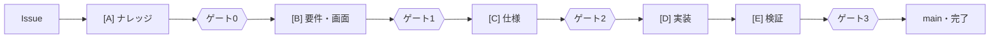

# 工場の回し方(人のための案内)

この文書は、**工場(ソフトウェアファクトリー)を回す人**のための案内です。
要望を出す人、問いに答える人、ゲートで判定してマージする人が、読む順に並べています。

- 決まりの正はここではありません。ここは案内とリンクだけで、決まりそのものはリンク先にあります。
  食い違ったときはリンク先が正しいので、この文書を直してください
- エージェント向けの指示は [AGENTS.md](../../AGENTS.md)、工場の考え方と決定は [ADR-0015](../adr/0015-software-factory.md) です
- 時刻は日本時間(JST)で書きます

## 目次

1. [全体像](#1-全体像)
2. [要望を投入して、工場を動かす](#2-要望を投入して工場を動かす)
3. [ゲートで人がやること](#3-ゲートで人がやること)
4. [問いへの答え方](#4-問いへの答え方)
5. [工場のハーネス](#5-工場のハーネス)
6. [工程に乗らない変更](#6-工程に乗らない変更)
7. [よくあるつまずき](#7-よくあるつまずき)
8. [計測](#8-計測)

## 1. 全体像

1 つの要望(Issue)は、5 つの工程と 4 つのゲートを通って main に入ります。
工程の成果物はエージェントが PR で出し、**人が PR をマージすることがゲートの承認**です。



| 工程 | 作るもの | 書く担当 | 確かめる担当 | ブランチ |
|---|---|---|---|---|
| [A] ナレッジ | 用語・業務ルール・未確定事項([knowledge/](../../knowledge/README.md)) | `knowledge-extractor` | 人(ゲート0) | `knowledge/<n>-…` |
| [B] 要件・画面 | EARS の要件・受け入れシナリオ・画面要件([requirements/](../../requirements/README.md)) | `requirements-writer`・`screen-writer` | `requirements-reviewer`、人(ゲート1) | `req/<n>-…` |
| [C] 仕様 | 処理ルール・OpenAPI・テスト計画([specs/](../../specs/README.md)) | `spec-writer` | 人(ゲート2) | `spec/<n>-…` |
| [D] 実装・[E] 検証 | コードとテスト | `implementer` | `code-reviewer`、CI、人(ゲート3) | `impl/<n>-…` |

- 担当(エージェント)の定義は [.claude/agents/](../../.claude/agents/) にあります。書く担当と確かめる担当は分けます
- Issue の状態は、列のラベル `stage:準備中` → `stage:着手待ち` → `stage:仕様確定` → `stage:実装中` と、
  ゲートラベル `gate0-approved`・`gate1-approved`・`gate2-approved` で表します。問いで止まると `stage:判断待ち` と `needs-answer` が付きます
- どの状態で何を進めてよいかの表は [factory-line スキル](../../.claude/skills/factory-line/SKILL.md) の「1.」にあります

## 2. 要望を投入して、工場を動かす

### 要望を投入する

1. GitHub で Issue を作り、テンプレート「[作業項目(機能の追加・変更・不具合)](../../.github/ISSUE_TEMPLATE/feature.yml)」を選びます。
   要求・受け入れ条件(案)・使うナレッジなどの欄があり、`stage:準備中` が自動で付きます
2. 分かっていない点は「上流で決めること」の欄に書きます。エージェントが問いにして返します

### 工場を動かす

**工場は自動では動きません。** Issue を作っても、PR をマージしても、ラベルを付けても、エージェントは起動しません。
人が Claude Code に頼んだときに、1 つの Issue の工程を 1 つだけ進めて、次のゲートの手前で止まります。

| 頼み方 | 動き |
|---|---|
| 「Issue #46 を進めて」 | その Issue の、いま進めてよい工程を 1 つ進める |
| 「Issue を確認して進めて」 | 進めてよい Issue のうち、番号の古いものから 1 つ進める |
| `/loop 30min Issue を確認して進めて` | 30 分ごとに上を繰り返す。進めてよい Issue がなければ何もしない |

進め方の手順は [issue-response スキル](../../.claude/skills/issue-response/SKILL.md) にあります。
エージェントは PR を出し、CI を見届け、Issue にコメントして止まります。マージ・PR の Ready 化・承認・ゲートラベルの付与はしません。

## 3. ゲートで人がやること

### PR を判定する

PR の本文の「レビューView」(事実・理由・問い)を読み、差分を全部読まずに判定できるようにしてあります。
ゲートごとに確かめる観点は [gate-review スキル](../../.claude/skills/gate-review/SKILL.md) の「ゲートごとの確認観点」にあります。

### マージしたあとにやること

マージしただけでは、次の工程は始まりません。次の 3 つを人がやります。

| ゲート | マージする PR | Issue に付けるラベル | 列を移す先 |
|---|---|---|---|
| ゲート0 | `knowledge/<n>-…` | `gate0-approved` | `stage:準備中` のまま |
| ゲート1 | `req/<n>-…` | `gate1-approved` | `stage:着手待ち` |
| ゲート2 | `spec/<n>-…` | `gate2-approved` | `stage:仕様確定` |
| ゲート3 | `impl/<n>-…` | なし(PR の `Closes #n` で Issue が閉じる) | なし |

1. Issue にゲートラベルを付け、列(`stage:…`)を移す
2. 付けたラベルの組み合わせは、ワークフロー「工場のラベルの確認」がその場で確かめる。ゲートを飛ばした・列と合わない・その工程の PR がマージされていない、なら Issue にコメントが付く(#77)。次の工程の PR が既に開いていて「工場のゲート」が失敗していれば、失敗したジョブも再実行される
3. Claude Code に「Issue #n を進めて」と頼む

- ナレッジに足すものがない Issue は、[A] が PR なしで終わることがあります。そのときもゲート0 のラベルは人が付けます
- 承認する画面の画像は人が撮ります(`bash tools/factory/update-approved-screens.sh`。[requirements/screens/](../../requirements/screens/README.md))

## 4. 問いへの答え方

エージェントは、分からないことを推測で埋めず、問いにして返します。問いの置き場所は次の 2 つです。

- 未確定事項 [knowledge/open-questions.md](../../knowledge/open-questions.md) の `OQ-…`
- PR の本文の「問い」と、確かめる担当(`requirements-reviewer`・`code-reviewer`)のコメントの「人に決めてほしいこと」

**回答は Issue のコメントに書きます。** チャットに書くと、次のセッションのエージェントには届きません。
エージェントは Issue のコメントを読んで、問いを出した工程からやり直し、`open-questions.md` の「回答」と「回答日」を PR で埋めます。

```markdown
## 回答

- OQ-007: A(入力欄は小数点を受け付けない)
- PR #59 のレビューの問い 1: Yes(入力欄の要件を次の req/ の PR に入れてから、ゲート1 にかける)

/intervention 回答 要件 OQ-007 と PR #59 のレビューの問いに回答
```

- 問いの ID と選択肢の記号(A・B・C、Yes・No)で答えます。文章だけだと解釈がずれます
- 最後の `/intervention` の行は、人が手を出したことの記録です(種類は 回答・差し戻し・手直し・CI承認、原因は ナレッジ・要件・仕様・工場)。
  書き方は [gate-review スキル](../../.claude/skills/gate-review/SKILL.md) の「判定する人が手を出したら」にあります
- `needs-answer` が付いていたら、答えたあとで人が外します
- Issue の問いがすべて答えられるまで、ゲート1(投入ゲート)は通しません

## 5. 工場のハーネス

ハーネスは、エージェントを導く・止める・確かめる仕組みの総称です。

| 種類 | 中身 | 正 |
|---|---|---|
| 導く | 共通の指示 | [AGENTS.md](../../AGENTS.md)、[CLAUDE.md](../../CLAUDE.md) |
| 導く | 工程の担当(7 つ) | [.claude/agents/](../../.claude/agents/) |
| 導く | 手順と規約(スキル) | [.claude/skills/](../../.claude/skills/)。工場の運転は `issue-response`・`factory-line`・`gate-review`、作業の規約は `domain-design`・`feature-dev`・`testing`・`docs-update`・`ci-and-env`・`commit` |
| 止める | 権限の拒否 | [.claude/settings.json](../../.claude/settings.json) の `permissions.deny` |
| 止める | フック | [.claude/hooks/guard.sh](../../.claude/hooks/guard.sh)。マージ・Ready 化・承認・ゲートラベルの付け外し・main への push・強制 push・承認した画面の書き換えなどを止める。止める操作の一覧は [guard.test.sh](../../.claude/hooks/guard.test.sh) |
| 止める | main のルールセット | 必須チェックとマージの制限。作るのは [tools/factory/setup-github.sh](../../tools/factory/setup-github.sh)(人が実行する) |
| 止める | Dev Container の通信の制限 | [.devcontainer/devcontainer.json](../../.devcontainer/devcontainer.json)(外への通信を許可リストに絞る) |
| 確かめる | ゲートの検査(CI) | [tools/factory/README.md](../../tools/factory/README.md) の「検査」。EARS・曖昧語・網羅・ナレッジ・画面・持ち場・ゲートラベル・前提の版・閉じるキーワード・工場の版と、画面の差分 |
| 確かめる | プロダクトの CI | [.github/workflows/ci.yml](../../.github/workflows/ci.yml)(バックエンド・フロントエンド・ブラウザE2E・ミューテーションテストなど) |

## 6. 工程に乗らない変更

| 変更 | 通し方 | 正 |
|---|---|---|
| 工場そのものの改善(指示・スキル・CI・フック) | Issue テンプレート「[工場の改善](../../.github/ISSUE_TEMPLATE/factory-improvement.yml)」で起票し、`factory/<名前>` ブランチの PR で直す(例: `factory/66-changes-per-file`)。変更の記録 `.factory/changes/<Issue番号>.md` を 1 ファイル足す | [.factory/changes/README.md](../../.factory/changes/README.md)、[.factory/CHANGELOG.md](../../.factory/CHANGELOG.md)(変更の種類 A〜D) |
| 判定を楽にする下ごしらえ(レビューView の見直し・テストの強化) | `prep/<n>-…` ブランチ。判断待ちが溜まったときにエージェントが選ぶ | [factory-line スキル](../../.claude/skills/factory-line/SKILL.md) の「6.」 |
| 成果物を人が手で直したくなったとき | 手で直さず、ナレッジ・要件・仕様・工場のどこが悪かったかを「工場の改善」で直す | [AGENTS.md](../../AGENTS.md) の「守ること」 |
| 要件の変わらない技術的な改善(型の導入、依存の更新など) | **未決。** いまは [A]〜[D] のどれにも素直に乗らない(`impl/` はゲート2 のラベルと前提の版を求める。`factory/` は `frontend/src/` などを変えられない) | なし |
| アーキテクチャの決定(ADR) | **未決。** `docs/adr/` を変えられるのは実質 `factory/` ブランチだけで、プロダクトの設計判断を通す工程がない | [docs/adr/](../adr/README.md) |
| 依存の更新(Dependabot) | `dependabot/…` ブランチは持ち場と工場の版の検査の対象外。CI を通してからマージする。メジャー更新は破壊的変更を確かめる | [ci-and-env スキル](../../.claude/skills/ci-and-env/SKILL.md) |

ブランチごとに変えてよい場所は [tools/factory/checks/branch.mjs](../../tools/factory/checks/branch.mjs) の `ROLES` が正です。

## 7. よくあるつまずき

| 起きたこと | 原因 | 対処 |
|---|---|---|
| ゲートラベルを付けたのに「ゲートラベルの確認」が赤いまま | 足りないゲートラベルがある(その工程までの全部が要る)か、ゲートラベルの工程の PR がマージされていない(#77) | 失敗の理由を読み、ラベルを直す。直すと「工場のラベルの確認」が失敗したジョブを再実行する(権限がなく再実行できなかったら、Actions で手で再実行する) |
| Issue に「ゲートラベル・列のラベルの組み合わせが…」というコメントが付いた | ラベルを付け間違えた(ゲートを飛ばした・列と合わない) | コメントの指摘どおりにラベルを直す。直すとコメントが「解消」に書き換わる |
| PR をマージしたら Issue が途中で閉じた | 本文の `Closes #n` を GitHub は否定の文の中でも読む(#57) | 作業項目を閉じてよいのは `impl/` の PR の `Closes #n` だけ(工場の改善の Issue は `factory/` の PR で閉じてよい)。ほかは `Refs #n` と書く。CI「作業項目を途中で閉じない」が止める |
| 要件の PR がテストで落ちてマージできない | 要件の工程で書いたシナリオには、まだステップも実装もない(#60) | 足したシナリオか `ルール:` に `@未実装` を付ける。実装の PR で外す([requirements/README.md](../../requirements/README.md)) |
| 2 つのエージェントの変更が 1 つのブランチに混ざった | 同じ作業フォルダで、片方が別のブランチに切り替えた(#61) | エージェントを並べて動かすときは、別の worktree で動かす(Claude Code の Agent の `isolation: worktree`) |
| 工場の PR が 2 つ同時に開くと衝突する | 以前は全員が同じ CHANGELOG の表の末尾に行を足していた(#66) | 変更の記録を `.factory/changes/<Issue番号>.md` に 1 件 1 ファイルで書く |
| 「前提の版」が赤い | 前提にした要件・仕様が、作業の途中で main で変わった | エージェントは止まる。変わった前提で作業をやり直すかを人が決める([.factory/premises/README.md](../../.factory/premises/README.md)) |
| PR で「バックエンド」などのジョブが skipped になっている | 変えた場所に関係しないジョブは飛ばす(#73)。飛ばしたジョブは必須チェックとしては通ったものとして扱われる | どのジョブを動かしたかは、ジョブ「変えた場所の判定」の実行サマリにある。対応は [ci-and-env スキル](../../.claude/skills/ci-and-env/SKILL.md)。main への push ではすべて動く |
| 工場の検査を足したのに必須チェックにならない | 必須チェックは main で一度動いたジョブ名からしか作れない | マージ後に人が `bash tools/factory/setup-github.sh` を実行する |

## 8. 計測

| もの | いつ | 中身 | 正 |
|---|---|---|---|
| 工場の週報 | 毎週月曜 09:00 JST(手動でも動く) | 直近 7 日の WIP・流れの時間(起票 → ゲート0〜2 → 完了)・マージした PR・介入。「工場の週報」Issue にコメントで足す | [tools/factory/README.md](../../tools/factory/README.md) の「計測」 |
| WIP の上限 | 週報で知らせる | 判断待ち 5 件まで・未回答の問い 10 件まで・着手待ち 2 件以上。超えたらエージェントは新しい工程に着手せず下ごしらえをする | [factory-line スキル](../../.claude/skills/factory-line/SKILL.md) の「6.」 |
| 介入の記録 | `/intervention` のコメントのたび | 形を確かめて `intervention` ラベルを付ける | [.github/workflows/factory-intervention.yml](../../.github/workflows/factory-intervention.yml) |

手元で数えるだけなら `node tools/factory/metrics-cli.mjs --days 30` です(投稿しません)。
